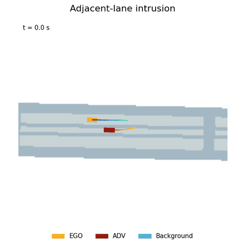
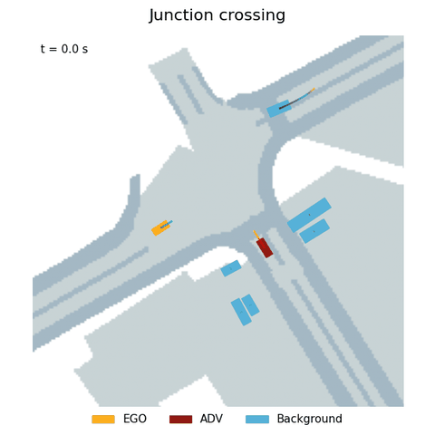
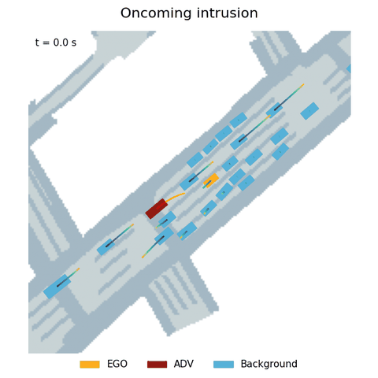
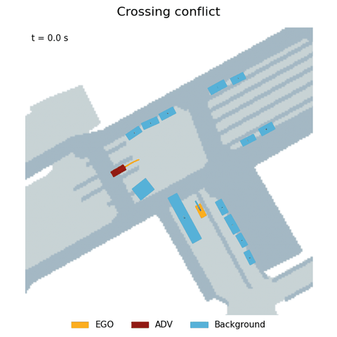

# AnchorDrive

**Language-controlled generation of safety-critical driving scenarios.**

AnchorDrive uses a Scenario Design Agent to define a natural-language goal, an LLM driver and Assessor to roll out the interaction, and anchor-guided diffusion to regenerate vehicle trajectories. An independent Reviewer evaluates the completed scenario.

<table>
<tr><td align="center"><b>Adjacent-lane intrusion</b><br></td><td align="center"><b>Junction crossing</b><br></td></tr>
<tr><td align="center"><b>Oncoming intrusion</b><br></td><td align="center"><b>Crossing conflict</b><br></td></tr>
</table>

Orange: EGO. Red: ADV. Blue: background vehicles. Rendered with SafeSim's nuScenes visualizer.

## Installation

Linux, Python 3.8, and an NVIDIA GPU are recommended for diffusion regeneration.

```bash
git clone https://github.com/Luminths/AnchorDrive.git
cd AnchorDrive
conda create -n anchordrive python=3.8 -y
conda activate anchordrive
pip install torch==2.4.1 torchvision==0.19.1 --index-url https://download.pytorch.org/whl/cu121
pip install -r requirements.txt
pip install -e . --no-deps
```

## Data and pretrained model

Download the [nuScenes](https://www.nuscenes.org/nuscenes) trainval dataset and map expansion, then link the data directory:

```bash
ln -s /path/to/nuscenes nuscenes
```

The data root should contain `v1.0-trainval/` and `maps/`. The first run preprocesses the selected scene through trajdata and builds its cache in `~/.unified_data_cache`.

Download **safesim_fut32** following the [SafeSim model instructions](https://github.com/jxmmy7777/safe-sim). The released weights are hosted in [SafeSim's checkpoint repository](https://huggingface.co/wjchang/safesim_checkpoints). Keep this layout:

```text
checkpoints/safesim_fut32/test/run0/
├── config.json
└── checkpoints/iter70000.ckpt
```

## Run

Set your OpenAI API key and run the complete **150-scene pipeline**:

```bash
export OPENAI_API_KEY="your-api-key"
python -m scripts.run_150 --output outputs/full150 --workers 4 --devices cuda:0
```

The default backend is **GPT-6.1 Sol** through the OpenAI Responses API, with `reasoning_effort="low"`. Scenario design, the Stage 1 planner and Assessor, anchor extraction, and the final Reviewer use this backend. Model and API settings are in `configs/scene_agent/openai_*.json`.

Each scene runs Goal generation → Stage 1 → Stage 2 → Reviewer. Simulation lasts up to 10 s, with LLM planning every 2 s and EGO decisions every 0.5 s. Stage 2 uses cosine anchor weighting from 10 to 3.

For multiple GPUs, distribute concurrent scene processes across the available devices:

```bash
python -m scripts.run_150 --output outputs/full150 --workers 8 --devices cuda:0,cuda:1
```

Adjust `--workers` to available GPU memory and API rate limits. The runner processes all 150 scenes even if an individual scene fails, and records progress in `outputs/full150/progress.json`. Per-scene logs, trajectories and results are saved under `outputs/full150/scene_XXX/attempt_YY/`.

Resume an interrupted batch or retry execution errors:

```bash
python -m scripts.run_150 --output outputs/full150 --workers 4 --devices cuda:0 --resume
```

Completed scenes are preserved, including completed simulations whose goals were not met. A retry writes a new attempt directory.

## Visualization

Render a completed rollout using SafeSim's nuScenes visualizer and the local trajdata cache:

```bash
python -m scripts.render_scene \
  --scene-dir outputs/full150/scene_000/attempt_01/stage2/execute_000/scene_000 \
  --output outputs/scene_000.mp4
```

The video uses a 90 m view by default (`--view-m`), with orange EGO, red ADV and blue background vehicles. The renderer reads the exported trajectory without changing it.

## Evaluation

Build the real-driving reference from the same local nuScenes cache, then score all 150 declared scenarios without rerunning simulation or calling an API:

```bash
python -m scripts.build_metric_reference --output outputs/metric_reference.npz
python -m scripts.score_scenarios \
  --run outputs/full150 --stage stage2 \
  --reference outputs/metric_reference.npz \
  --dataset nuscenes --output outputs/metrics_stage2
```

Use `--stage stage1` to evaluate Stage 1. The same scorer accepts a directory containing `execute_XXX/scene_XXX` outputs. For externally stored reviews or explicitly selected attempts, use `--manifest`: a JSON array with `scene_index`, `directory`, and optional `review` and `pipeline_wall_s` fields. Paths are relative to the manifest. Missing executions count as task/contact failures; scoring errors and unfinished reviews stop aggregation.

The scorer writes `summary.json` and `scene_metrics.csv`, including:

- Task success and ADV–EGO collision rates over all declared scenes, using saved final-review evidence.
- ADV–BG and BG–BG collision rates, excluding original vehicle pairs already overlapping initially.
- Full-body ADV and BG off-road rates against annotated drivable areas with a 0.25 m tolerance. Initially off-road BG vehicles are excluded from the BG denominator.
- Per-scene ADV maximum speed, acceleration, yaw rate and jerk, averaged over valid trajectories.
- Three separate raw and normalized Wasserstein distances, using all finite signed samples and a fixed real-reference standard deviation. The SafeSim component and boundary conventions are retained. Scene distances are averaged, rather than pooling generated samples across scenes.
- Stage wall time, diffusion time, review time and recorded pipeline wall time, with separate coverage counts. Missing times remain null; these scopes must not be substituted for each other.

Rates are stored as fractions. Trajectory-quality metrics include valid executions that fail the task; unavailable quality values are not replaced by zero. The reference uses original non-EGO vehicle tracks from frames 11–131 in all 150 scenes and contains no generated goals. Keep this reference fixed across methods. Sampling defaults to 0.1 s; use matching `--dt` values in both commands for another interval. Different sampling intervals can change WD rankings.

`--distribution histogram` reproduces finite-bin W1 as a diagnostic. `--sparse-waypoints` evaluates Stage 1's original waypoints within executed intervals as a sensitivity analysis; the default evaluates the executed trajectory. These options define different metrics and should be labeled separately.

`python -m scripts.score_api_cost --help` provides token and USD price-equivalent accounting for explicitly selected API logs, using prices supplied by the caller. Use the same stages and retry scope across methods.

## Code structure

- `tbsim/scene_agent/`: scenario design, driver, Assessor, anchor extraction and Reviewer.
- `tbsim/models/`, `tbsim/algos/`, `tbsim/utils/`: diffusion model, guidance and simulation utilities.
- `scripts/`: pipeline entry points and visualization.
- `configs/`: model and simulation settings.

## Acknowledgments

Built on [SafeSim](https://github.com/jxmmy7777/safe-sim), [traffic-behavior-simulation](https://github.com/NVlabs/traffic-behavior-simulation), [trajdata](https://github.com/NVlabs/trajdata), and [nuScenes](https://www.nuscenes.org/nuscenes).

## License

Research and non-commercial use. See [LICENSE](LICENSE) and [third-party licenses](LICENSES.md).
